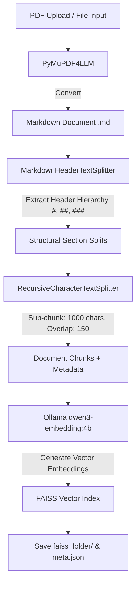
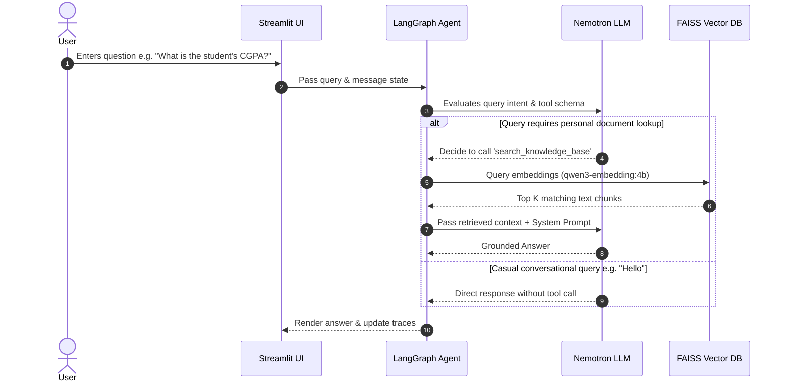

#  Personal RAG Question Answering System

An intelligent, local-first Retrieval-Augmented Generation (RAG) agent that builds a searchable knowledge base from your personal documents (resumes, transcripts, certificates, project reports) and provides grounded answers using **NVIDIA Nemotron** and local embeddings.

---

##  Tech Stack

- **Orchestration Framework:** [LangGraph](https://github.com/langchain-ai/langgraph) (State Graph & Agentic Workflow)
- **Large Language Model (LLM):** `nvidia/nemotron-3-super-120b-a12b` (via NVIDIA API Catalog / OpenAI-compatible endpoint)
- **Embedding Model:** `qwen3-embedding:4b` (executed locally via [Ollama](https://ollama.com/))
- **Document Parsing & Extraction:** `pymupdf4llm` (PDF to Markdown conversion preserving structure)
- **Vector Database:** [FAISS](https://github.com/facebookresearch/faiss) (Facebook AI Similarity Search)
- **Text Splitter:** `langchain-text-splitters` (`MarkdownTextSplitter`)
- **Frontend / UI:** [Streamlit](https://streamlit.io/) (3-pane responsive layout)
- **Environment & Runtime:** Python 3.10+, `python-dotenv`

---

##  Architecture & Data Flow

### 1. Document Ingestion Flow



### 2. Query & Agent Execution Flow



---

## Project Directory Structure

```text
personal-rag-system/
│
├── data/                             # Knowledge Base Store (Auto-generated)
│   └── <Document_Name>/              # Dedicated folder per uploaded file
│       ├── <Document_Name>.pdf       # Original uploaded PDF file
│       ├── <Document_Name>.md        # Extracted Markdown representation
│       ├── meta.json                 # File metrics & timing metadata
│       └── faiss_folder/             # Local FAISS Vector Index
│           ├── index.faiss
│           └── index.pkl
│
├── .env                              # Environment variables (API keys)
├── agent.py                          # LangGraph state graph, tools & LLM setup
├── ingest.py                         # Ingestion pipeline (PDF -> MD -> Embeddings -> FAISS)
├── app.py                            # Streamlit 3-Pane User Interface
├── requirements.txt                  # Python dependencies
└── README.md                         # Project documentation

```

---

## Performance & Metadata Tracking (`meta.json`)

Each ingested document generates execution metadata to track timing across processing stages:

```json
{
    "file_name": "Adarsh_Resume.pdf",
    "file_size_bytes": 1048576,
    "chunks_created": 4,
    "timings_seconds": {
        "pdf_to_markdown": 0.468,
        "text_chunking": 0.005,
        "embedding_and_indexing": 11.201,
        "total_processing_time": 11.674
    }
}

```

---

## Getting Started

### Prerequisites

1. **Python 3.10+** installed.
2. **Ollama** installed and running locally with the embedding model pulled:
```bash
ollama pull qwen3-embedding:4b

```


3. An active **NVIDIA API Key** for Nemotron (`nvidia/nemotron-3-super-120b-a12b`).

### 1. Clone & Setup Environment

```bash
git clone [https://github.com/your-username/personal-rag-system.git](https://github.com/your-username/personal-rag-system.git)
cd personal-rag-system

# Create virtual environment
python -m venv venv

# Activate virtual environment
# Windows:
venv\Scripts\activate
# Linux/macOS:
source venv/bin/activate

```

### 2. Install Dependencies

```bash
pip install -r requirements.txt

```

> **Note:** Ensure `langchain-ollama` is installed to avoid deprecation warnings.

### 3. Environment Variables

Create a `.env` file in the root directory:

```env
NVIDIA_API_KEY=nvapi-your-actual-nvidia-api-key-here

```

### 4. Run the Application

```bash
streamlit run app.py

```

---

##  UI Layout Overview

The Streamlit interface is divided into 3 distinct functional panes:

1. **Left Pane (Knowledge Base Input):** Upload PDFs. Ingestion runs strictly once and persist on disk (`data/`).
2. **Center Pane (Assistant Chat):** Interactive chat interface for asking questions about your personal background.
3. **Right Pane (Agent Traces):** Displays execution metrics, orchestration details, and active model parameters in real time.

---

##  Target QA Capabilities

The system handles direct, document-grounded queries including:

* **Full Name & Contact Info:** Email, phone, location.
* **Academic Qualifications:** College/University, Degree, CGPA/Percentage.
* **Technical Skills:** Programming languages, frameworks, developer tools.
* **Projects & Internships:** Final-year project technologies, company names, key deliverables.
* **Certifications & Achievements:** Earned certifications, awards, research interests.

*If information is not present in the uploaded documents, the agent explicitly states that the requested details are unavailable.*

